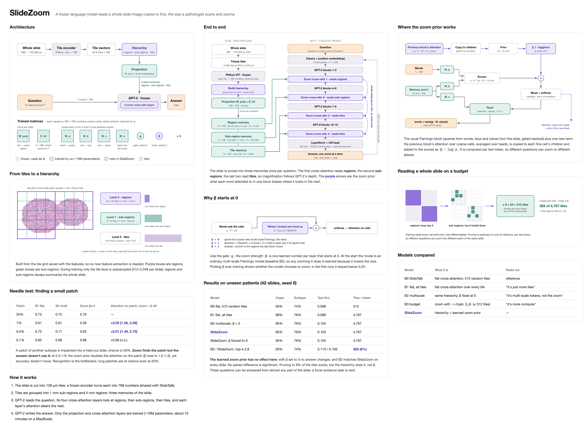

# SlideZoom

**Progressive-zoom cross-attention:** a frozen language model reads a whole-slide image from coarse to fine,
the way a pathologist scans at low magnification and then zooms in.

Builds on [SlideTalk](https://github.com/KumarDeepankar/slidetalk) (frozen GPT-2 + Flamingo-style gated cross-attention over Phikon tile
features). It uses the same slides, labels and questions, and leaves SlideTalk untouched.



## Problem

SlideTalk reads a **random 512 of ~4,000–20,000 tiles** per slide. A small tumour focus can be missing from
the sample, and attending to every tile in every block costs too much.

## Idea

Build a hierarchy from the tile grid (tiles are 128 µm):

| Level | Cell | Token |
|---|---|---|
| 0 region | 32 × 32 tiles (~4 mm) | mean of its tiles |
| 1 sub-region | 8 × 8 tiles (~1 mm) | mean of its tiles |
| 2 tile | 1 tile | Phikon feature |

The 4 cross-attention blocks read the slide coarse to fine, along GPT-2's depth:

```
GPT-2 block 3  ──► x-attn over regions
GPT-2 block 6  ──► x-attn over sub-regions  ┐
GPT-2 block 9  ──► x-attn over tiles        ├ guided by the previous block's attention
GPT-2 block 12 ──► x-attn over tiles        ┘
```

**Zoom prior.** For each text token *t*, the previous block's attention (at the coarser level) biases this
block's logits:

```
logits_l(t, c) = q_t · k_c / √d  +  β_l · log a_{l-1}(t, ancestor(c))
```

- β starts at **0**, so at initialisation the model is a plain multi-scale Flamingo model; training decides
  how much to zoom. Like the gates, it starts at zero.
- The prior is computed per text token, so each question can zoom into a different place.
- **Top-k at inference** (`--topk 2,8`): each token reads only the children of the top-2 regions, then of the
  top-8 sub-regions, so at most 8 × 64 = 512 tiles out of the whole slide.

Code: `slidezoom/model.py` (`ZoomCrossAttention`, `SlideZoomer._xattn`) and `slidezoom/hierarchy.py`.

## Models compared (same code, `--mode`)

| Name | Command | Rules out |
|---|---|---|
| B0 SlideTalk | `--mode flat --train-tiles 128,512 --eval-tiles 512` | reference |
| B1 flat, all tiles | `--mode flat` | "the gain only comes from more tiles" |
| B2 multiscale | `--mode multiscale` (β fixed at 0) | "the gain comes from multi-scale tokens, not the zoom" |
| B3 budget | zoom checkpoint, `test.py --topk 2,8` | "the gain comes from more compute" |
| **Zoom** | `--mode zoom` | — |

Except for B0, all models train on 512–2,048 random tiles per slide per step (coarse levels always summarise
the whole slide), and are evaluated on every tile.

## Results (seed 0, 42 held-out patients)

All models were trained the same way (25 epochs, about 6–15 minutes each on an M3 Pro) and tested on the same
42 patients. `bash scripts/run_baselines.sh` reproduces the table; `scripts/compare.py` gives the paired tests.

| Model | Organ | Subtype | Choice | Yes/no (true / false) | Test NLL | Tiles scored per token |
|---|---|---|---|---|---|---|
| B0 flat, 512 random tiles | 93% | 74% | 81% | 76 / 93% | 0.098 | 512 |
| B1 flat, all tiles | 98% | 76% | 81% | 79 / 93% | 0.089 | 4,797 |
| B2 multiscale, β = 0 | 95% | 76% | 81% | 76 / 95% | 0.104 | 4,797 |
| SlideZoom | 95% | 76% | 81% | 76 / 95% | 0.103 | 4,797 |
| SlideZoom with β forced to 0 at test time | 95% | 76% | 81% | 76 / 95% | 0.104 | 4,797 |
| B2, top-k 2,8 | 93% | 74% | 81% | 76 / 93% | 0.110 | 383 |
| SlideZoom, top-k 2,8 | 93% | 74% | 81% | 76 / 93% | 0.109 | 383 |

**What this shows**

- **The learned zoom prior has no effect on these questions.** Setting β to 0 in the trained model changes no
  answer on any slide (NLL difference −0.001). B2, which never learns β, gives the same answers as SlideZoom on
  every slide, with and without top-k. β grew only to 0.07–0.22, too small to move the attention.
- **No model is significantly better than another.** Every paired McNemar p is 1.0 and every 95% CI includes 0.
  B1 has the lowest NLL, but its CI against SlideZoom is [−0.002, +0.039].
- **Reading a whole slide on a budget works, but the hierarchy does it, not β.** B2 and SlideZoom both keep
  their accuracy (at most 2 points lost) while scoring 8% of the tiles, because pruning follows the previous
  block's attention.
- **These questions can't separate the models.** All four train to the same validation ceiling (NLL
  0.037–0.039), because the cancer type is visible almost anywhere on the slide.

**So the main question, whether zooming helps when the evidence is small and local, is still untested.** Next:
the focal-evidence task in the measurement plan, starting β at 1 rather than 0, and more seeds / CV folds.
Caveat: one seed and 42 test slides (±13 points on an accuracy), and B2 and SlideZoom share an initialisation.

## Needle test: finding a small patch (seed 0, 41 held-out patients)

Built from the existing features (`slidezoom/data.py: make_composite`). A test slide gets a contiguous patch
from **another subtype of the same organ** covering 20% … 0.1% of its tiles, and the model is asked
*"Is there any ⟨that subtype⟩ in this slide?"* (yes). As a control, the slide gets a patch from **another slide
of its own subtype** and is asked about a different subtype (no). Both contain a foreign patch, so only
recognising what is in the patch earns credit. Chance is 50%. All five models were retrained with half the slides
turned into composites (`bash scripts/run_needle.sh`, ~1.5 h). The 4 normal-kidney slides that were labelled
chromophobe are now excluded, so the test set has 41 patients.

**Accuracy (82 composites per size, 95% CI about ±10 points)**

| Patch | B0 512 tiles | B1 flat | B2 multiscale | Zoom, β from 0 | Zoom, β from 1 |
|---|---|---|---|---|---|
| 20% | 0.74 | 0.73 | 0.72 | 0.67 | 0.70 |
| 5% | 0.68 | 0.71 | 0.70 | 0.67 | 0.71 |
| 1% | 0.61 | 0.61 | 0.61 | 0.59 | 0.59 |
| 0.5% | 0.72 | 0.72 | 0.71 | 0.71 | 0.63 |
| 0.1% | 0.63 | 0.65 | 0.66 | 0.68 | 0.66 |

**Where the attention goes.** Share of tile-level attention (last prompt token) on the patch, relative to chance,
for zoom with β from 1, paired on identical composites (×, with 95% bootstrap CI):

| Compared with | 1% patch | 0.5% patch | 0.1% patch |
|---|---|---|---|
| B1 flat, every tile | **×1.96** [1.42, 2.64] | ×1.29 [0.93, 1.78] | ×0.52 [0.27, 0.96] |
| B2 multiscale | **×2.29** [1.77, 3.01] | **×1.76** [1.32, 2.34] | ×0.81 [0.40, 1.59] |
| the same model with β switched off | **×2.05** [1.58, 2.58] | **×2.01** [1.49, 2.70] | ×0.80 [0.47, 1.27] |

**What this shows**

- **Zoom finds the patch, but the answer doesn't use it.** At 0.5–1% patches the zoom prior roughly doubles the
  attention on the patch, and switching β off in the same model halves it again (higher in 89–94% of cases).
  On this task the model kept the prior: β started at 1 and ended at 1.01, 1.21 and 1.27. Accuracy doesn't move.
- **At 0.1% (1–5 tiles) the zoom doesn't help.** A mean over a 1,024-tile region hardly changes when one tile does,
  so the coarse levels can't see it. Top-k pruning loses patches of 1% and smaller for the same reason.
- **Recognising the patch is the bottleneck, not finding it.** Even 20% patches are only about 70% right, and size
  barely matters. Split by organ (5–20% patches), kidney works (0.77 patch present / 0.85 control for B1), but **lung
  is at chance** (0.60 / 0.53): the models can't tell adenocarcinoma from squamous in a patch, although they name
  whole lung slides. That suggests the whole-slide answers lean on slide-wide cues; this is a hypothesis.
- On kidney alone there is still no decline with patch size and no difference between models, and at small sizes
  the models mostly answer "no". So no model reads small patches yet, and this version of the task can't test
  zoom on accuracy.

Caveats: one seed, 25 epochs (validation curves were still rising), a synthetic task, and attention measured at
one token. Next: a cross-organ needle (an easy-to-recognise patch, so finding it is the hard part), longer
training and more seeds.

## Run

```bash
# Python 3.11, same requirements as SlideTalk
python -m venv .venv && source .venv/bin/activate && pip install -r requirements.txt
python -m pytest tests -q

python scripts/train.py --mode zoom --out runs/zoom                 # ~12 min on an M3 Pro
python scripts/test.py  --ckpt runs/zoom/best.pt                    # every tile
python scripts/test.py  --ckpt runs/zoom/best.pt --topk 2,8         # tile budget
python scripts/compare.py runs/flat512/test_best_t512_kall_v1 runs/zoom/test_best_tall_kall_v1
```

`--fold 0..4` gives 5-fold patient-level cross-validation; use it with several `--seed` values for error bars.
42 test slides alone give a ±13-point 95% CI, too wide to see a 5-point gain.

`data/features` links to the Phikon features already extracted for SlideTalk (or set `SLIDEZOOM_FEATURES`).

## Measurement plan

1. **Baseline with error bars:** B0 under 5-fold CV × 5 seeds.
2. **Global tasks (subtype, organ):** zoom should be non-inferior to B0 (within 2 points). Little gain is
   expected, because any 512 tiles show the cancer type.
3. **Focal task (main experiment, not built yet):** implant a block of tumour tiles covering f = 20% … 0.1%
   of a normal-tissue slide and plot accuracy against f. Random sampling must fail as f shrinks; zoom should not.
   Needs TCGA "Solid Tissue Normal" slides.
4. **Mechanism:** β > 0 in every seed; attention mass on the implanted region; deletion test (removing the
   top-attended tiles hurts more than removing random tiles); attention entropy falls with depth.
5. **Efficiency:** accuracy vs tiles read (top-k sweep).

## Prior work to set apart

HIPT (Chen et al., CVPR 2022) is a hierarchical slide encoder that isn't conditioned on a question. ZoomMIL
(Thandiackal et al., ECCV 2022) zooms differentiably for classification, without a language model.
Flamingo/Perceiver use single-scale cross-attention. The difference here is **zooming conditioned on each text
token, across the depth of a frozen language model.**
